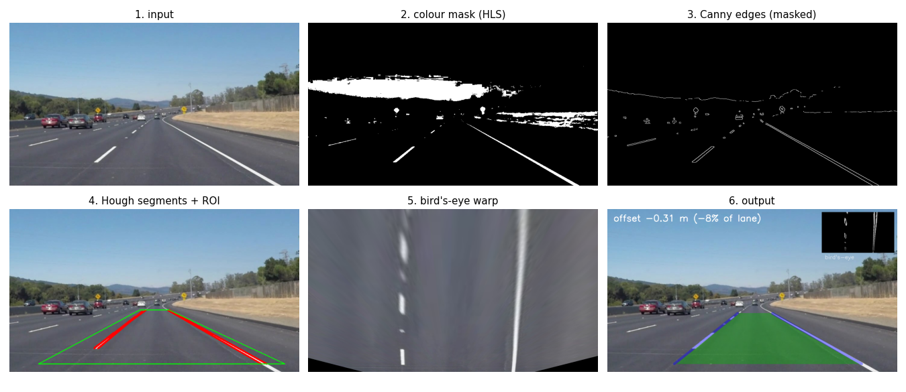
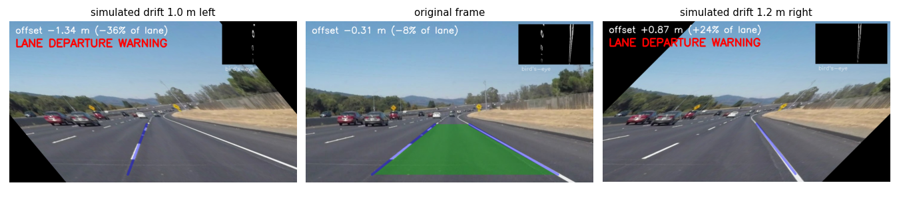

# Project 1: Road Lane Detection and Lane Departure Warning


## Problem statement
A driver-assistance system has to know where the lane is and warn the driver when the car drifts out of it.
Given dash-camera video, find the left and right lane lines in every frame, estimate how far the car is
from the lane centre, and raise a warning when the car is close to leaving the lane.

## Objective
- Detect both lane lines robustly (white and yellow, solid and dashed, shadows and changing asphalt colour).
- Estimate the car's lateral offset from the lane centre in metres.
- Raise a lane-departure warning when the offset exceeds 20% of the lane width (0.74 m for a 3.7 m lane).
- Measure detection rate, stability and warning accuracy.

## Dataset
Udacity Self-Driving Car Nanodegree lane-line samples (public, MIT licence):
https://github.com/udacity/CarND-LaneLines-P1. We use 3 videos (`solidWhiteRight.mp4` 221 frames,
`solidYellowLeft.mp4` 681 frames, `challenge.mp4` 251 frames with shadows, a curve and a concrete bridge) and the 6 test images.
See [DATASET.md](DATASET.md) for download instructions. The videos have no lane labels (see Evaluation).

## Methodology (classical computer vision, no learning)


1. **Colour mask in HLS space.** White paint has high lightness and yellow paint has hue 15–40. Keeping only these pixels removes
   most edges from shadows, cracks and asphalt seams.
2. **Grayscale, Gaussian blur (5×5), Canny edges (50/150)**, kept only where the colour mask is set.
3. **Region of interest:** a trapezoid covering the road in front of the car.
4. **Probabilistic Hough transform** (`cv2.HoughLinesP`) finds straight line segments.
5. **Line fitting:** segments with negative slope belong to the left line and positive slope to the right line
   (image y points down). Near-horizontal segments (|slope| < 0.4) are rejected. One line per side is fitted as the
   length-weighted mean slope and intercept.
6. **Temporal smoothing:** an exponential moving average (α = 0.2) over frames. A line that goes missing is kept for 5 frames
   (dashed lines have gaps), then dropped.
7. **Perspective warp (bird's-eye view):** `cv2.getPerspectiveTransform` maps the road trapezoid to a rectangle, where
   lane width is constant. We measure the lane width and the car position (image centre) in this view, convert the offset
   to metres using a 3.7 m lane, and warn when |offset| > 0.74 m. If only one line is visible, the other is placed one
   remembered lane width away, so the warning still works while the car crosses a line.

## Tools / libraries
Python 3.10, OpenCV (colour spaces, Canny, Hough, perspective transform, video I/O), NumPy, Matplotlib, Pillow (GIFs).

## How to run
```bash
pip install -r requirements.txt
bash ../download_data.sh lane                   # downloads to ../data/lane (see DATASET.md)
cd src
python lane_detection.py --input ../../data/lane/solidWhiteRight.mp4 --output ../results/out.mp4
python evaluate.py   --data ../../data/lane     # all videos x 3 configurations -> results/metrics.md, GIFs, plots
python drift_test.py --data ../../data/lane     # simulated departures -> results/drift_test.json
```

## Results

### 1. Detection and stability on the real videos (`results/metrics.md`)
| video | config | frames | both lines detected % | jitter bottom (px/frame) | lane-width CV % | warnings % |
|---|---|---|---|---|---|---|
| solidWhiteRight | **full pipeline** | 221 | 100.0 | 0.7 | 0.6 | 0.0 |
| solidYellowLeft | **full pipeline** | 681 | 100.0 | 0.7 | 1.0 | 0.0 |
| challenge | **full pipeline** | 251 | 98.4 | 1.7 | 2.0 | 0.0 |
| challenge | no colour mask | 251 | 98.4 | 4.1 | 7.4 | **2.0 (false)** |
| challenge | no smoothing | 251 | 98.4 | 7.5 | 2.7 | 0.0 |

- On the two easy videos both lines are found in every frame. On `challenge`, 4 frames (1.6%) miss the left line
  (bridge / shadow); smoothing bridges the gap.
- **Ablation, colour mask:** on `challenge`, removing the HLS mask makes the lines 2.4× more jittery, makes the lane width
  3.7× less stable (shadow and road-seam edges get fitted) and causes 5 false departure warnings. On the easy videos it makes no difference.
- **Ablation, temporal smoothing:** removing it makes the lines 4–5× more jittery on every video.
- The car stays in its lane in all videos, so 0 warnings is the correct output. The mean |offset| is 0.13–0.21 m
  (`results/*_offset.png`).

### 2. Departure-warning accuracy on simulated drift (`results/drift_test.json`)
The videos contain no departures, so we simulate them. A homography that shifts the **road plane** sideways by
d metres (warp to bird's-eye, translate, warp back) makes the car appear d metres off its true position. We take
53 frames (6 images + every 25th video frame) and apply 25 shifts from −1.2 m to +1.2 m, giving 1325 tests. The
expected offset is the frame's own measured offset + d.

| metric | value |
|---|---|
| tests with an offset estimate | 1325 / 1325 (100%) |
| offset error, mean / 90th percentile | 0.018 m / 0.035 m |
| warning accuracy | 98.2% |
| warning precision / recall | 98.7% / 96.9% |
| confusion (TP / FP / FN / TN) | 527 / 7 / 17 / 774 |



The first version assigned lines to a side by screen half (left line must be in the left 55% of the image).
In this test it detected only 58% of shifted frames and the warning **recall was 8%**: it failed exactly when the car departed,
because the line it was crossing moved past the image centre. Switching to slope-sign assignment plus the one-line fallback
raised recall to 96.9%. This is the main design change the evaluation produced.

## Things to try (modify and re-run)
- `DEPARTURE_THRESHOLD` in `src/lane_detection.py` (0.20): lower gives earlier warnings and more false alarms. Rerun `drift_test.py`.
- `SMOOTH_ALPHA` (0.2): 1.0 disables smoothing. Compare the jitter in `evaluate.py`.
- `CANNY_LOW/HIGH`, `HOUGH_THRESHOLD`, or the HLS thresholds in `color_mask()`, then watch `challenge.mp4`.
- `--no-color` / `--no-smooth` flags on `lane_detection.py`.

## Limitations
See [REPORT.md](REPORT.md). In short: straight-line model (curves are approximated), no ground-truth labels for absolute
accuracy, fixed camera geometry, simulated rather than real departures, daytime highway only.

## Conclusion
A purely classical pipeline (colour mask, Canny, Hough, perspective warp) detects both lane lines in 98–100% of frames on
the Udacity videos, stays stable (≤ 2 px jitter per frame), and gives 98% warning accuracy on 1325 simulated departures.
The colour mask and temporal smoothing both matter, mainly on the hard `challenge` video. The evaluation also exposed a real
bug, side assignment by screen half, that would have hidden almost every real departure.

## Folder contents
`src/` code · `results/` output videos, metrics (`metrics.md`, `metrics.json`, `drift_test.json`), plots ·
`samples/` GIFs, annotated test images, pipeline figure · `REPORT.md` · `DATASET.md` · `requirements.txt`
