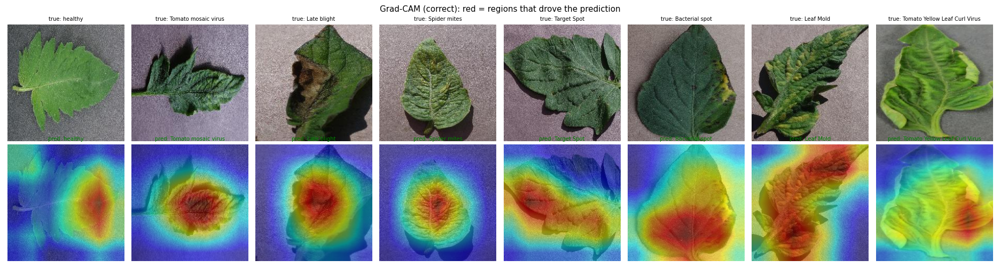
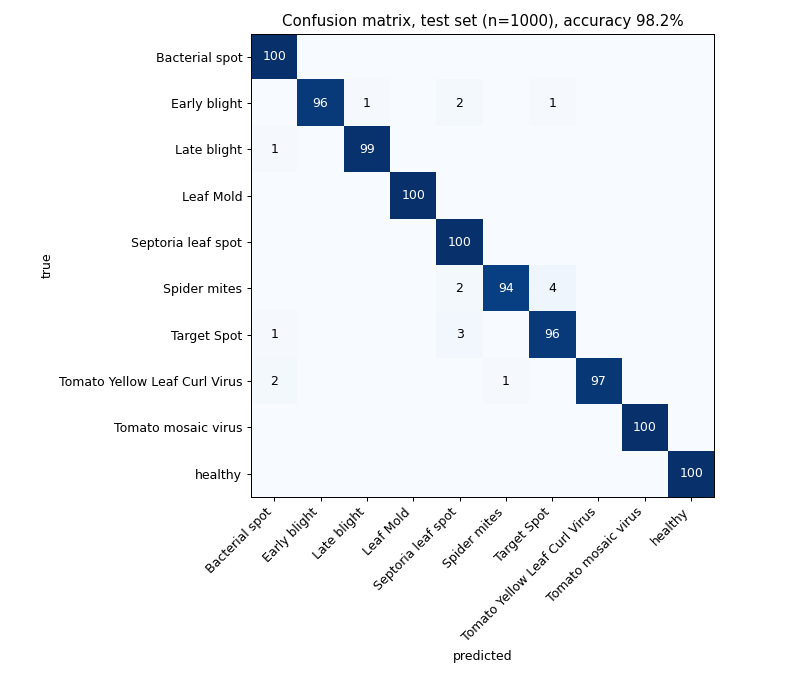
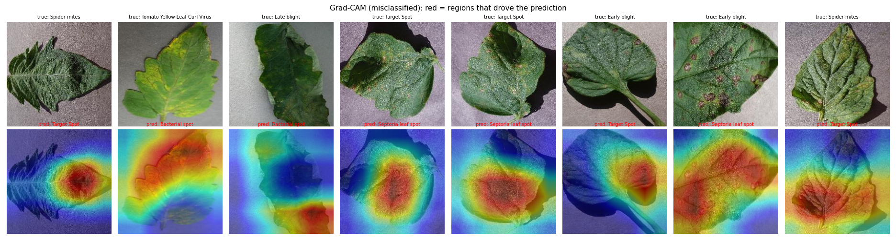

# Project 2: Tomato Leaf Disease Classification with Transfer Learning and Grad-CAM



## Problem statement
Crop diseases cause large yield losses, and farmers often cannot identify them early. Given a photo of a tomato leaf,
classify it as healthy or as one of 9 diseases, and show **which part of the leaf** the decision is based on, so a user
can judge whether to trust the prediction.

## Objective
- Train an accurate 10-class classifier quickly by transferring ImageNet features (minutes on a laptop GPU).
- Compare **feature extraction** (frozen backbone) with **full fine-tuning**.
- Explain predictions with **Grad-CAM** and check quantitatively that the model looks at the leaf, not the background.
- Test robustness to photo degradations (blur, noise, lighting, JPEG compression) and improve it.

## Dataset
PlantVillage, tomato subset ("Tomato leaf disease detection", Kaggle `kaustubhb999/tomatoleaf`, CC0):
10 classes, 1000 training + 100 test images per class (11,000 RGB images, 256×256, single leaf on a plain background).
Split used: 9,000 train / 1,000 validation (random 10% of train, used for model selection) / **1,000 test** (the dataset's
own `val` folder, never used for training or selection). See [DATASET.md](DATASET.md).

## Methodology
1. **Preprocessing:** resize 256 → centre-crop 224 and ImageNet mean/std normalisation. Training augmentation: random resized crop
   (scale 0.7–1), horizontal and vertical flips, colour jitter. The *robust* variant also uses Gaussian blur (σ 0.5–3, p = 0.3) and
   Gaussian noise (σ ≤ 0.12, p = 0.3).
2. **Model:** ResNet-18 pretrained on ImageNet. The final layer is replaced by a 10-way linear layer.
3. **Training:** AdamW, one-cycle LR schedule (3e-4 for fine-tuning, 1e-3 for the linear probe), label smoothing 0.05, mixed precision,
   batch 64, 5 epochs. The checkpoint with the best validation accuracy is kept.
4. **Evaluation:** accuracy, macro-F1, per-class precision/recall, confusion matrix on the 1,000 test images.
5. **Explainability:** Grad-CAM on the last ResNet block (`layer4`). To measure where the model looks, we segment the leaf
   (HSV saturation threshold) and compute the share of Grad-CAM activation that falls on leaf pixels.
6. **Robustness:** test images degraded with Gaussian blur (radius 3), darkening (×0.5), brightening (×1.6), Gaussian noise
   (σ = 25/255) and JPEG quality 10.

## Tools / libraries
Python 3.10, PyTorch 2 + torchvision (ResNet-18, transforms), pytorch-grad-cam, scikit-learn (metrics), OpenCV, Matplotlib, Kaggle API.
Hardware: RTX 4050 Laptop GPU (6 GB). One fine-tuning run takes about 1.5 minutes.

## How to run
```bash
pip install -r requirements.txt
bash ../download_data.sh tomato                     # -> ../data/tomato/tomato/{train,val}
cd src
python train.py --mode linear   --epochs 5 --out ../results/linear
python train.py --mode finetune --epochs 5 --out ../results/finetune
python train.py --mode finetune --epochs 5 --robust-aug --out ../results/finetune_robust
python evaluate.py                                    # metrics, confusion matrix, robustness, Grad-CAM figures
python predict.py --image some_leaf.jpg --out gradcam.png   # uses results/finetune_robust/model.pt (included)
```

## Results (1,000 test images)
| model | trainable params | train time | test accuracy | macro-F1 |
|---|---|---|---|---|
| ResNet-18 linear probe (frozen backbone) | 5,130 | 50 s | 79.9% | 79.5% |
| ResNet-18 full fine-tune | 11.2 M | 81 s | 98.2% | 98.2% |
| ResNet-18 full fine-tune + blur/noise augmentation | 11.2 M | 105 s | **98.4%** | **98.4%** |

- **Fine-tuning vs feature extraction:** ImageNet features alone reach 80%. Adapting all layers reaches 98%. Leaf-disease
  textures are far from ImageNet objects, so the backbone itself has to change.
- **Per class** (`results/classification_report.txt`): F1 ≥ 0.955 for every class. Leaf Mold, Mosaic virus and Healthy are perfect.
  The remaining confusions are between spot-type diseases (Target Spot ↔ Septoria/Bacterial spot, Spider mites → Target Spot,
  Early blight → Target Spot/Septoria). See `results/confusion_matrix.png`.



### Robustness to degraded photos (`results/robustness.md`)
| test condition | fine-tune | fine-tune + blur/noise aug |
|---|---|---|
| clean | 98.2% | 98.4% |
| Gaussian blur | **19.2%** | 97.1% |
| Gaussian noise | **22.0%** | 97.4% |
| darker ×0.5 | 96.9% | 96.1% |
| brighter ×1.6 | 92.6% | 92.1% |
| JPEG quality 10 | 75.4% | 81.8% |

The standard model collapses on blurred or noisy photos: it relies on fine texture that blur and noise destroy. Adding these
degradations as training augmentation recovers 97% without losing clean accuracy. Note that the test degradations are of the
same type as the augmentation, so this shows robustness to *these* degradations, not to real field photos in general.

### Grad-CAM (`samples/gradcam_correct.png`, `samples/gradcam_errors.png`)
On 341 test images with a clean leaf segmentation, the leaf covers 53% of the image but receives **69%** of the Grad-CAM
activation. In **94%** of images most of the activation is on the leaf. The model mostly looks at lesions and discoloured
areas, not the background. Among the misclassified images, some heat-maps sit on the background or on the leaf edge
(e.g. Late blight → Bacterial spot), which gives a visible reason not to trust those predictions.



## Things to try (modify and re-run)
- `--epochs 2` vs `--epochs 10`, or `--lr`. Watch `results/training_curves.png`.
- Swap `resnet18` for `models.efficientnet_b0` or `mobilenet_v3_small` in `build()` (needs the classifier head renamed).
- Change the degradation strength in `perturb()` in `evaluate.py`.

## Limitations
PlantVillage images are lab photos: one leaf, plain background, good lighting. Accuracy on real field photos (many leaves,
soil, sun and shadow) is known to be much lower, and we could not measure it here. See [REPORT.md](REPORT.md).

## Conclusion
Transfer learning with a fine-tuned ResNet-18 classifies 10 tomato leaf conditions at 98.4% test accuracy after under 2 minutes of
training. Grad-CAM shows the decisions are mostly based on diseased leaf regions. A simple robustness test revealed a serious
weakness (about 20% accuracy under blur or noise), and targeted augmentation fixed it at no cost in clean accuracy.

## Folder contents
`src/` (train, evaluate, predict) · `results/` metrics, plots, logs, `finetune_robust/model.pt` (trained weights) ·
`samples/` Grad-CAM figures · `REPORT.md` · `DATASET.md` · `requirements.txt`
