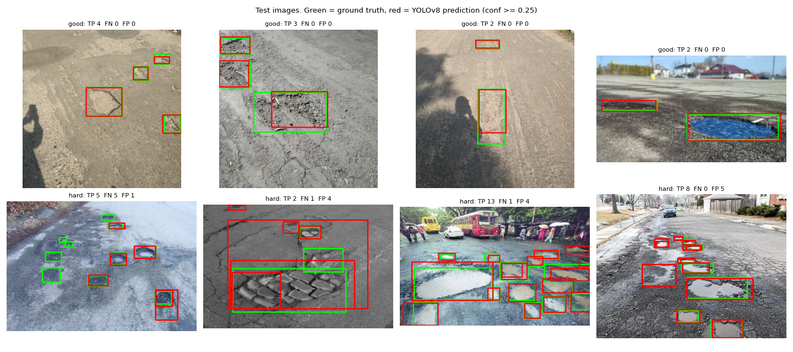
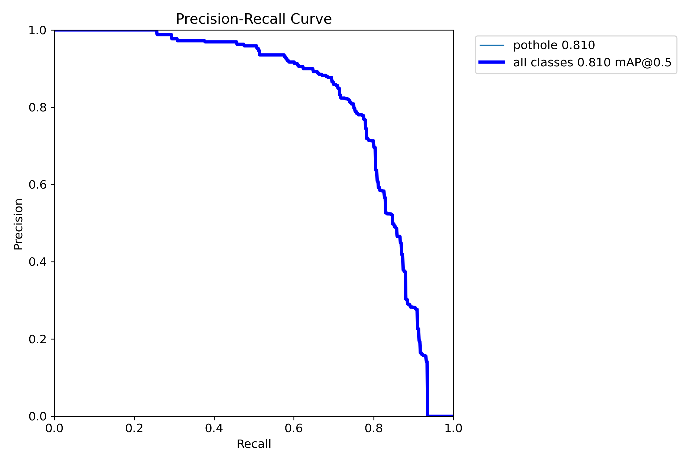

# Project 3: Road Pothole Detection with YOLOv8



## Problem statement
Potholes damage vehicles and cause accidents, and road authorities find them mostly through manual surveys or complaints.
Given a road image (for example from a dash-cam), **locate every pothole with a bounding box**, so that potholes can be
mapped and counted automatically.

## Objective
- Fine-tune a COCO-pretrained YOLOv8 detector on a small pothole dataset (665 images) in a few minutes on a laptop GPU.
- Evaluate on a held-out test split with standard detection metrics (precision, recall, mAP@0.5, mAP@0.5:0.95).
- Compare a nano and a small model, and analyse which potholes are missed (size).

## Dataset
Kaggle "Pothole Detection" (`andrewmvd/pothole-detection`): 665 road images with 1,739 pothole boxes (Pascal VOC XML).
We converted it to YOLO format and split it **70/15/15 by image (seed 42): 465 train / 100 val / 100 test** images
(1,212 / 251 / 276 boxes). See [DATASET.md](DATASET.md).

## Methodology
1. **Preprocessing** (`src/prepare_data.py`): parse the VOC XML, clip boxes to the image, convert to normalised YOLO format
   `class cx cy w h`, and split the data.
2. **Model:** YOLOv8 (one-stage, anchor-free detector: CSP backbone, PAN neck, decoupled box/class head), pretrained on COCO.
   The 80-class head is replaced by a 1-class head (pothole).
3. **Training** (`src/train.py`): 50 epochs, 640 px input, batch 16, default Ultralytics augmentation (mosaic, HSV jitter,
   flips, scale/translate), SGD/AdamW auto-selected, early-stopping patience 20. The best epoch by validation mAP is kept.
4. **Evaluation:** the best weights are evaluated **once on the test split** (never seen in training or selection). Metrics:
   precision, recall, mAP@0.5, mAP@0.5:0.95. Error analysis (`src/analyze.py`) gives recall by box size and false
   positives per image at confidence 0.25.

## Tools / libraries
Python 3.10, Ultralytics YOLOv8 (PyTorch), OpenCV, NumPy, Matplotlib, Kaggle API. GPU: RTX 4050 Laptop (6 GB).

## How to run
```bash
pip install -r requirements.txt
bash ../download_data.sh pothole          # downloads and converts to ../data/pothole_yolo
cd src
python train.py --model yolov8n.pt --epochs 50 --name yolov8n
python train.py --model yolov8s.pt --epochs 50 --name yolov8s
python analyze.py --weights ../results/runs/yolov8n/weights/best.pt
python detect.py --source my_road_photo.jpg   # uses models/pothole_yolov8n.pt (included, 6 MB)
```
(The trained `weights/` folders are not committed. `models/pothole_yolov8n.pt` is the YOLOv8n best checkpoint.)

## Results

### Test split (100 images, 276 potholes)
| model | params | train time (50 ep) | precision | recall | mAP@0.5 | mAP@0.5:0.95 |
|---|---|---|---|---|---|---|
| YOLOv8n | 3.0 M | 4.3 min | 0.858 | 0.702 | **0.810** | 0.505 |
| YOLOv8s | 11.1 M | 6.1 min | 0.845 | 0.713 | 0.796 | 0.505 |

(Validation mAP@0.5: n 0.818, s 0.842.) The two models perform about the same on the test set. With only 465 training
images, the 3.7× larger model does not help, so **YOLOv8n is the better choice** (smaller and faster). The test set is small
(100 images), so differences of ±0.02 mAP are within noise.

Curves and matrices: `results/runs/yolov8n_test/` (`BoxPR_curve.png`, `BoxF1_curve.png`, `confusion_matrix.png`) and the
training curves in `results/runs/yolov8n/results.png`.



### Error analysis (YOLOv8n, confidence ≥ 0.25, IoU ≥ 0.5, `results/error_analysis.json`)
| pothole size (box area / image) | potholes | detected | recall |
|---|---|---|---|
| small (< 1%) | 94 | 65 | 69% |
| medium (1–5%) | 98 | 77 | 79% |
| large (> 5%) | 84 | 75 | 89% |

False positives: 0.67 per image. Small, distant potholes are the main source of misses. Visually, some "false positives"
in the hard examples look like real potholes that were not annotated (see the figure above). This is an observation, not a
measured number.

## Things to try (modify and re-run)
- `--epochs 100`: validation mAP was still rising at epoch 50 for both models.
- `--imgsz 960`: may help small potholes (slower training).
- `--conf` in `analyze.py` / `detect.py`: trades recall against false positives.

## Limitations
Small dataset (665 images, mixed sources and resolutions), single random split, one training run per model, inconsistent
annotation of small or distant potholes, no depth or severity estimate, and no real dash-cam video test. Details in [REPORT.md](REPORT.md).

## Conclusion
Fine-tuning a pretrained YOLOv8n for about 4 minutes gives **mAP@0.5 = 0.81** on held-out images. It finds 89% of large potholes but
only 69% of small ones. Model size did not matter at this data scale. More (and more consistently labelled) data and higher
input resolution are the clearest ways to improve.

## Folder contents
`src/` (prepare_data, train, analyze, detect) · `models/pothole_yolov8n.pt` · `results/` test metrics JSON, error
analysis, Ultralytics plots (`runs/`), training logs · `samples/` prediction figure · `REPORT.md` · `DATASET.md` · `requirements.txt`
