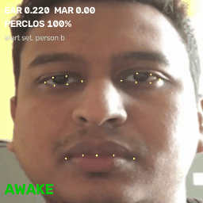
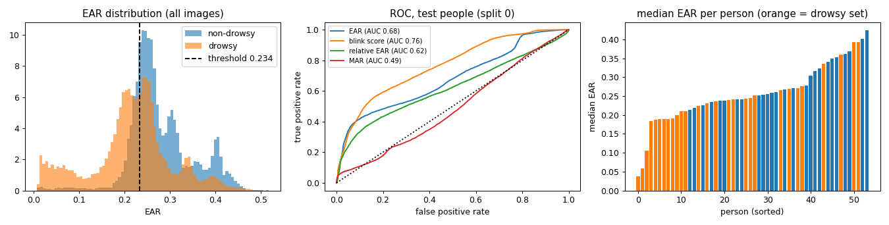
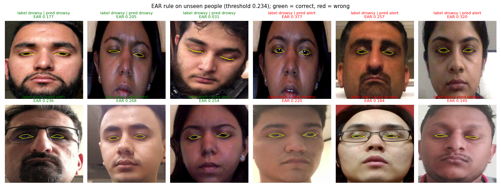

# Project 4: Driver Drowsiness Detection with Facial Landmarks (EAR + PERCLOS)

<p> </p>

*Left: a person from the drowsy set triggers the alert. Right: a person from the alert set stays "AWAKE".*

## Problem statement
Drowsy driving causes a large share of road accidents. A camera facing the driver can watch the eyes and raise an alarm
when they close for too long. Given face images or a live webcam stream, decide whether the driver is drowsy and
raise an alert in real time, **without training a neural network** (interpretable, rule-based logic on facial landmarks).

## Objective
- Extract eye and mouth geometry from 478 facial landmarks (MediaPipe Face Landmarker).
- Compute the **Eye Aspect Ratio (EAR)** and **Mouth Aspect Ratio (MAR)** and decide with thresholds plus temporal logic
  (consecutive closed frames, **PERCLOS** = percentage of eye closure over time).
- Tune thresholds and evaluate on DDD **with person-wise splits** (tested on people never used for tuning).
- Provide a live webcam demo.

## Dataset
**Driver Drowsiness Dataset (DDD)**, Kaggle `ismailnasri20/driver-drowsiness-dataset-ddd`: 41,793 face crops (227×227)
extracted from videos of drivers. 22,348 "Drowsy" and 19,445 "Non Drowsy", from 28 drowsy and 26 non-drowsy recording
sessions (file prefixes A…ZC and a…zc). See [DATASET.md](DATASET.md).

## Methodology
1. **Landmarks:** MediaPipe Face Landmarker (BlazeFace detector + 478-point face mesh, CPU, about 12 ms per image), which also
   outputs "blendshape" scores such as `eyeBlinkLeft/Right`.
2. **Eye Aspect Ratio** for each eye from 6 landmarks (corners p1, p4; upper lid p2, p3; lower lid p6, p5):
   `EAR = (|p2−p6| + |p3−p5|) / (2·|p1−p4|)`, averaged over both eyes. It is high (about 0.3) for open eyes and near 0 for closed eyes,
   and does not depend on face size.
3. **Mouth Aspect Ratio** = mean inner-lip opening / mouth width, for yawn detection.
4. **Frame rules:** drowsy if EAR < t. Variants: blink score > t; EAR < t or MAR > t; EAR relative to the person's own
   90th-percentile EAR (per-person calibration).
5. **Temporal logic** (`DrowsinessMonitor`): alert if the eyes are closed for ≥ 15 consecutive frames (0.5 s at 30 fps), or if
   PERCLOS over the last 90 frames is ≥ 40%. Yawns are counted when MAR stays high for 20 frames. On DDD we evaluate PERCLOS
   over windows of 30 consecutive frames of the same person.
6. **Evaluation protocol:** DDD prefixes are different people, so a random image split would put near-identical frames of
   the same person in both tuning and test sets. We split **by person**: thresholds are tuned for balanced accuracy on 40% of the
   people and tested on the other 60%, repeated for 5 random splits (mean ± std).

## Tools / libraries
Python 3.10, MediaPipe Tasks (Face Landmarker), OpenCV (video, drawing, webcam), NumPy, pandas, scikit-learn (metrics), Matplotlib.

## How to run
```bash
pip install -r requirements.txt
bash ../download_data.sh ddd
cd src
python extract_features.py           # EAR/MAR/blink for all 41,793 images -> results/features.csv (~2 min, 12 processes)
python evaluate.py                    # person-wise evaluation -> results/metrics.md, thresholds.json, plots
python demo_sequence.py --group N --n 90 --out ../samples/demo_N.gif   # temporal demo on a DDD sequence
# live demo with an external USB webcam (index 1; laptop camera is usually 0), press q to quit:
python drowsiness.py --source 1 --calibrate
python drowsiness.py --source 1 --output webcam_demo.mp4      # also record the annotated video
```
`--calibrate` measures **your** open-eye EAR during the first 3 seconds (keep your eyes open and look at the camera) and sets
the threshold to 75% of it. EAR differs a lot between people and camera angles (see Results), so this is recommended for the live demo.
Without it, the DDD-tuned threshold from `results/thresholds.json` (EAR 0.234) is used.

## Results (people never seen during tuning, 5 person-wise splits, mean ± std)
| detector | accuracy | precision | recall | F1 | ROC-AUC |
|---|---|---|---|---|---|
| EAR < t (single frame) | 62.3 ± 2.7 | 69.4 ± 7.2 | 54.7 ± 7.8 | 60.5 ± 4.0 | 69.7 ± 3.3 |
| MediaPipe blink score > t (single frame) | 66.0 ± 1.8 | 73.8 ± 7.3 | 59.7 ± 13.0 | 64.5 ± 5.4 | 75.9 ± 2.7 |
| EAR < t or MAR > t (single frame) | 62.4 ± 2.5 | 69.3 ± 7.0 | 55.0 ± 8.2 | 60.6 ± 4.2 | – |
| EAR / person's p90 EAR < t (single frame) | 61.8 ± 0.7 | 76.8 ± 8.8 | 42.5 ± 5.9 | 54.0 ± 3.3 | 65.3 ± 2.4 |
| **PERCLOS over 30 frames (temporal)** | **66.4 ± 6.9** | 66.3 ± 5.4 | **76.6 ± 21.2** | **69.2 ± 11.5** | 74.7 ± 5.7 |

A face was found in 99.94% of the images.



**What the numbers say:**
- **EAR separates the classes only moderately** (AUC 0.70). The left plot shows the drowsy distribution shifted to lower EAR but
  heavily overlapping. The right plot explains why: **open-eye EAR differs strongly between people** (median EAR per person
  ranges from 0.21 to 0.42 in the alert set), so one global threshold cannot fit everyone.
- **DDD labels are per session, not per frame.** Many "drowsy" images show open eyes (see the red examples below: label drowsy,
  EAR 0.38). No eye-based frame rule can get these right, which caps frame-level accuracy.
- **Temporal logic helps:** PERCLOS over 1 s windows gives the best F1 (69%) and recall (77%). Drowsiness is a state over time,
  not a single frame.
- **MAR (yawning) adds nothing on DDD** (AUC 0.42): there are almost no yawns in these clips.
- **Per-person calibration** using the 90th percentile of the person's own EAR raised precision (77%) but lowered recall. For
  heavily drowsy people the 90th percentile is itself low. In a car you would calibrate at the *start* of the drive instead, which is what
  `--calibrate` does.



## Things to try (modify and re-run)
- `CLOSED_FRAMES`, `WINDOW`, `PERCLOS_ALERT` in `src/drowsiness.py` (alert sensitivity vs false alarms).
- `--ear 0.20` on the webcam demo, with and without `--calibrate`.
- `WIN = 30` in `src/evaluate.py` (temporal window): longer windows smooth more.

## Limitations
Weak, session-level labels; mostly frontal, well-lit faces; no glasses-glare, night/IR or head-pose evaluation; DDD
thresholds may not transfer to another camera (hence `--calibrate`). Details in [REPORT.md](REPORT.md).

## Conclusion
Landmark geometry gives an explainable, training-free drowsiness detector that runs in real time on a CPU. Evaluated honestly
on unseen people, single-frame EAR reaches only about 62% accuracy on DDD, because eye openness varies between people and the labels
are per session. Temporal PERCLOS reaches 66% accuracy and 77% recall. The live system therefore combines temporal logic with a
per-driver calibration step.

## Folder contents
`src/` (drowsiness = live system, extract_features, evaluate, demo_sequence) · `models/face_landmarker.task` (MediaPipe
model, 3.7 MB) · `results/` features.csv, metrics, thresholds.json, plots · `samples/` GIF demos and example predictions ·
`REPORT.md` · `DATASET.md` · `requirements.txt`
