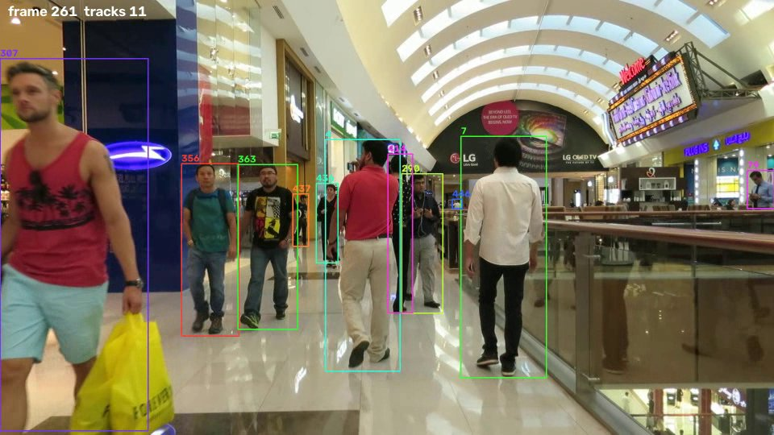

# Project 5: Multi-Object Tracking (YOLOv8 + ByteTrack / BoT-SORT) on MOT17


## Problem statement
Detecting people in single frames is not enough for surveillance, crowd analytics, retail or autonomous driving: we
need to know **who is who over time**. Each pedestrian must keep one ID across the whole video, through occlusions and
crowds. Given a video, output a box and a persistent ID for every person in every frame.

## Objective
- Build a tracking-by-detection system from a **pretrained** detector (no training) and a modern association tracker.
- Evaluate it against MOT17 ground truth with the standard metrics (MOTA, IDF1, ID switches, MT/ML).
- Compare two detectors (YOLOv8n vs YOLOv8s) and two trackers (ByteTrack vs BoT-SORT), and tune the confidence threshold.

## Dataset
**MOT17** (MOTChallenge, https://motchallenge.net/data/MOT17/), training sequences (which have public ground truth).
We use 3 of the 7: **MOT17-02** (static camera, street, 600 frames, 62 people), **MOT17-04** (static elevated camera, dense
pedestrian street at night, 1050 frames, 83 people) and **MOT17-11** (moving camera in a shopping mall, 900 frames,
75 people), all 1920×1080 at 30 fps. 2,550 frames and 220 ground-truth identities in total. See [DATASET.md](DATASET.md).

## Methodology
1. **Detection:** YOLOv8 pretrained on COCO, class "person" only, input 1280 px, confidence ≥ 0.1. The low threshold
   is deliberate, because ByteTrack uses low-score boxes.
2. **Association (tracking):**
   - Each track's box is predicted into the next frame with a **Kalman filter** (constant-velocity model).
   - Predictions and detections are matched by **IoU** with the **Hungarian algorithm**.
   - **ByteTrack:** first matches high-score detections, then tries to match the *remaining tracks* with **low-score detections**.
     This recovers partly occluded people instead of discarding them. Unmatched tracks are kept for 30 frames before being deleted.
   - **BoT-SORT:** the same idea plus **camera-motion compensation** (global motion estimated between frames), which helps with a
     moving camera.
3. **Output:** MOTChallenge text format (`frame, id, x, y, w, h, conf`) in `results/tracks/<config>/`.
4. **Evaluation** (`src/evaluate.py`, py-motmetrics, IoU ≥ 0.5, simplified MOTChallenge protocol): targets are GT pedestrians
   (class 1) with the "consider" flag set. Tracker boxes that match distractor GT (static persons, people on vehicles,
   reflections) are ignored.
   - **MOTA** = 1 − (FN + FP + IDSW) / GT measures detection plus association errors.
   - **IDF1** measures how consistently the same ID is kept.
   - **MT/ML** = targets tracked for ≥ 80% / ≤ 20% of their lifetime.

## Tools / libraries
Python 3.10, Ultralytics YOLOv8 (detector and built-in ByteTrack/BoT-SORT), `lap` (assignment), py-motmetrics, pandas, SciPy, OpenCV.
GPU: RTX 4050 Laptop.

## How to run
```bash
pip install -r requirements.txt
bash ../download_data.sh mot17          # ~5.5 GB zip; test split is not extracted
cd src
python track.py --seq ../../data/mot17/MOT17/train/MOT17-02-FRCNN --model yolov8s.pt --tracker bytetrack.yaml \
                --out ../results/tracks/yolov8s_bytetrack/MOT17-02.txt --video ../results/videos/MOT17-02.mp4
python evaluate.py --sweep             # all configs in results/tracks -> metrics.md, conf_sweep.md
python track.py --seq my_video.mp4 --out ../results/my_video.txt --video ../results/my_video_tracked.mp4   # your own video
```

## Results

### Overall (3 sequences, 2,550 frames, 220 identities)
| detector + tracker | MOTA | IDF1 | precision | recall | ID switches | mostly tracked | mostly lost | FPS* |
|---|---|---|---|---|---|---|---|---|
| YOLOv8n + ByteTrack | **43.8%** | 50.6% | 84.4% | 54.2% | 300 | 52 | 79 | 40 |
| YOLOv8s + ByteTrack | 40.9% | 51.9% | 77.4% | 58.3% | 299 | 66 | 74 | 28 |
| YOLOv8s + BoT-SORT | 40.5% | **52.7%** | 76.7% | 58.7% | **271** | **69** | **70** | 21 |
| YOLOv8s + ByteTrack, boxes conf ≥ 0.4 | 42.8% | 52.8% | 84.9% | 52.5% | 282 | – | – | 28 |

\*FPS is end-to-end (detection + tracking) on the RTX 4050 laptop GPU at 1280 px. The YOLOv8s + ByteTrack run also wrote the output video.

Per sequence (`results/metrics.md`): MOT17-04 is easiest (MOTA 45–49%, IDF1 54–57%). MOT17-02 is hardest (MOTA 29%,
recall < 40%: many small, heavily occluded people far from the camera). On MOT17-11 (moving camera), BoT-SORT has more false
positives than ByteTrack (MOTA 34% vs 41%) but a similar IDF1.

### Findings
- **Detector size vs MOTA:** YOLOv8s finds more people (recall +4 points) but also many more false positives at the low
  confidence threshold, so its MOTA is *lower*. MOTA penalises FP and FN equally.
- **Confidence threshold** (`results/conf_sweep.md`): for YOLOv8s, keeping only boxes with confidence ≥ 0.4 raises MOTA
  40.9 → 42.8% (precision 77 → 85%). For YOLOv8n, any threshold lowers MOTA, because it already has few FPs. The best operating point depends on the detector.
- **ByteTrack vs BoT-SORT:** BoT-SORT gives the best identity metrics (IDF1 52.7%, fewest ID switches, most mostly-tracked
  targets) but runs about 25% slower. The differences are small.
- **Context:** published trackers trained *on MOT17* reach about 80% MOTA. Our detectors were never trained on MOT17 (COCO only), and
  missed detections (FN) are by far the largest error term (31–35k FN vs 7.5–13.5k FP). Detection quality, not association,
  limits performance here.



## Things to try (modify and re-run)
- `--conf 0.3` in `track.py`, or `--imgsz 960` (faster, fewer small people).
- `--tracker botsort.yaml`, and edit `track_buffer` / `match_thresh` in a copy of Ultralytics' `bytetrack.yaml`.
- Add other MOT17 sequences (05, 09, 10, 13) to the evaluation.

## Limitations
Only 3 of 7 training sequences; COCO-pretrained detector not adapted to MOT17; simplified evaluation protocol (not the
official TrackEval/HOTA); FPS measured on one laptop. Details in [REPORT.md](REPORT.md).

## Conclusion
A pretrained YOLOv8 with ByteTrack, with no training at all, tracks pedestrians on three MOT17 sequences at
**MOTA 43.8% / IDF1 50.6% at 40 FPS** (YOLOv8n), or IDF1 52.7% with YOLOv8s + BoT-SORT. The error breakdown shows that
missed detections of small or occluded people dominate, so fine-tuning the detector on pedestrian data would help more than a
better tracker. The confidence threshold must be tuned per detector.

## Folder contents
`src/` (track, evaluate) · `results/` metrics (`metrics.md/.csv/.json`, `conf_sweep.md`), tracker outputs in MOT format,
`videos/MOT17-02.mp4` · `samples/` GIFs and annotated frames · `REPORT.md` · `DATASET.md` · `requirements.txt`
