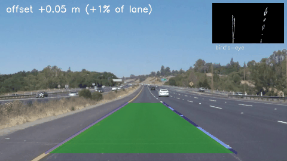
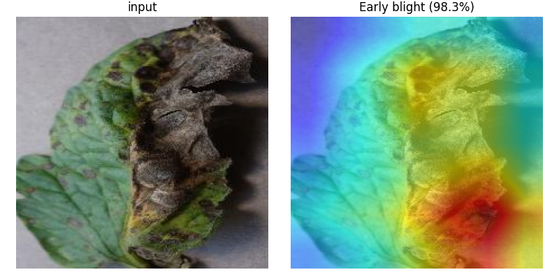
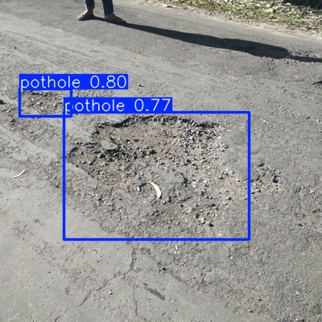
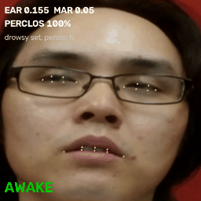
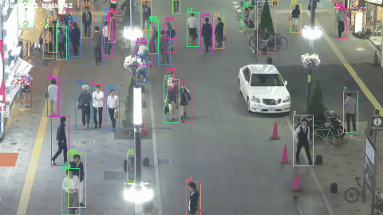

# Computer Vision Projects

Five computer-vision projects, each covering a different concept: classical image processing, transfer-learning
classification with explainability, object detection, facial-landmark analysis and multi-object tracking. Every project
folder contains its own README (problem, objective, dataset, method, tools, results, conclusion), source code,
`requirements.txt`, dataset information, results and evaluation, sample outputs and a short `REPORT.md`.

## Projects at a glance

| # | Project | CV concept | Dataset | Key result | Preview |
|---|---|---|---|---|---|
| **01** | [Lane Detection & Departure Warning](01_lane_detection/) | Classical CV: HLS colour mask, Canny, Hough transform, perspective warp | Udacity lane-line videos | Both lines found in 98–100% of frames; **98.2%** warning accuracy on 1,325 simulated departures |  |
| **02** | [Tomato Leaf Disease Classification](02_crop_disease/) | Transfer learning (ResNet-18) + Grad-CAM explainability | PlantVillage tomato (10 classes) | **98.4%** test accuracy; blur/noise accuracy 20% → 97% with targeted augmentation |  |
| **03** | [Pothole Detection](03_pothole_detection/) | Object detection (YOLOv8 fine-tuning) | Kaggle pothole dataset (665 images) | **mAP@0.5 = 0.81** on the held-out test split |  |
| **04** | [Driver Drowsiness Detection](04_drowsiness_detection/) | Facial landmarks (MediaPipe), EAR / MAR, temporal PERCLOS | Driver Drowsiness Dataset (DDD) | **69% F1** / 66% accuracy on unseen people (temporal); live webcam demo |  |
| **05** | [Multi-Object Tracking](05_object_tracking/) | Tracking-by-detection: YOLOv8 + ByteTrack / BoT-SORT (Kalman filter + Hungarian matching) | MOT17 (3 sequences) | **MOTA 43.8%, IDF1 50.6%** at 40 FPS, no training |  |

## Key technical highlights

- **Evaluation found a real bug (Project 1).** The lane videos contain no departures and no labels, so departures were
  simulated with a road-plane homography. The first version assigned lines to left/right by screen half and detected only
  8% of real departures, because the line being crossed moved past the image centre. Slope-based assignment fixed it (96.9% recall).
- **High accuracy can hide fragility (Project 2).** The fine-tuned ResNet-18 reaches 98% on clean test images but drops to
  19–22% under blur or sensor noise. Blur/noise augmentation restores 97% at no cost in clean accuracy. Grad-CAM shows 69% of the
  model's attention falls on the leaf, which covers 53% of the image.
- **Small data: model size does not help (Project 3).** YOLOv8s (3.7× more parameters) scores the same as YOLOv8n
  (0.80 vs 0.81 mAP@0.5) with 465 training images. Error analysis shows small potholes are the weakness (69% recall vs 89% for large ones).
- **Honest evaluation on unseen people (Project 4).** DDD's drowsy and alert sets contain different people, so images are split
  by person, never mixing one person into both tuning and test. Open-eye EAR ranges from 0.21 to 0.42 between people. Temporal
  PERCLOS beats single-frame rules, and the live demo calibrates to each driver.
- **Detection, not association, is the bottleneck (Project 5).** With a COCO-pretrained detector and no training on MOT17,
  missed people (31–35k FN) outweigh false boxes (7.5–13.5k FP) and ID switches (~300). A per-detector confidence threshold adds +2 MOTA points for YOLOv8s.

## Performance benchmarks
Measured on one laptop: AMD Ryzen 7 7435HS CPU, NVIDIA RTX 4050 Laptop GPU (6 GB). Batch size 1 (one frame at a time) after warm-up,
including preprocessing. Projects 01–04 use `python tools/benchmark.py`; Project 05 uses `05_object_tracking/src/track.py` on MOT17-09.

| project | task | hardware | latency per frame | throughput | key metric |
|---|---|---|---|---|---|
| 01 Lane detection | full pipeline + bird's-eye warp, 1280×720 | CPU | 11.4 ms | 88 FPS | 98.2% warning accuracy |
| 02 Crop disease | ResNet-18 classification, 224 px | RTX 4050 | 2.4 ms | 414 FPS | 98.4% test accuracy |
| 03 Pothole detection | YOLOv8n detection, 640 px | RTX 4050 | 7.2 ms | 139 FPS | 0.81 mAP@0.5 |
| 04 Drowsiness | face landmarks + EAR + temporal logic | CPU | 9.3 ms | 107 FPS | 69% F1 (temporal) |
| 05 Multi-object tracking | YOLOv8n (1280 px) + ByteTrack, incl. image reading | RTX 4050 | 24.5 ms | 41 FPS | 43.8% MOTA |

Project 02's Grad-CAM explanation is not included in its timing. In live webcam use, Project 04 is limited by the camera frame rate (usually 30 FPS).

## Quick start
These two demos run **without downloading any dataset**: the trained model and sample inputs are included.
```bash
git clone https://github.com/pushkardevp/cv-projects.git && cd cv-projects
python3 -m venv .venv && source .venv/bin/activate

# Project 02: classify a leaf and save a Grad-CAM heat-map (CPU or GPU)
pip install -r 02_crop_disease/requirements.txt
python 02_crop_disease/src/predict.py --image 02_crop_disease/samples/inputs/early_blight_leaf.jpg --out gradcam.png

# Project 01: detect lanes in a road image (CPU only)
pip install -r 01_lane_detection/requirements.txt
python 01_lane_detection/src/lane_detection.py --input 01_lane_detection/samples/inputs/solidWhiteCurve.jpg --output lanes.jpg
```

## Datasets
The datasets are not stored in this repository because they are too large. Download them from the original sources:

| Project | Dataset | Link | Size |
|---|---|---|---|
| 01 | Udacity lane-line test videos and images | [github.com/udacity/CarND-LaneLines-P1](https://github.com/udacity/CarND-LaneLines-P1) (folders `test_videos` and `test_images`) | 25 MB |
| 02 | Tomato Leaf Disease (PlantVillage subset) | [kaggle.com/datasets/kaustubhb999/tomatoleaf](https://www.kaggle.com/datasets/kaustubhb999/tomatoleaf) | 180 MB |
| 03 | Pothole Detection | [kaggle.com/datasets/andrewmvd/pothole-detection](https://www.kaggle.com/datasets/andrewmvd/pothole-detection) | 330 MB |
| 04 | Driver Drowsiness Dataset (DDD) | [kaggle.com/datasets/ismailnasri20/driver-drowsiness-dataset-ddd](https://www.kaggle.com/datasets/ismailnasri20/driver-drowsiness-dataset-ddd) | 2.6 GB |
| 05 | MOT17 multi-object tracking benchmark | [motchallenge.net/data/MOT17](https://motchallenge.net/data/MOT17/) | 5.5 GB |

Open a link, click **Download** and unzip the files into a `data/` folder in the repository (for example `data/tomato/`,
`data/pothole/`). Each project's `DATASET.md` describes the exact folder layout and how the data was split.

If you prefer the command line, `download_data.sh` does the same thing, for example `bash download_data.sh tomato`.
The Kaggle datasets then need a Kaggle API token (kaggle.com → Settings → API → Create New Token).

## Running the projects
Each project's README has the full commands to train, evaluate and demo it. A few examples:
```bash
python 03_pothole_detection/src/detect.py --source my_road_photo.jpg                # detect potholes in your own photo
python 04_drowsiness_detection/src/drowsiness.py --source 0 --calibrate             # live drowsiness check with a webcam
python 05_object_tracking/src/track.py --seq my_video.mp4 --out tracks.txt --video tracked.mp4   # track people in a video
```
Tested on Ubuntu 22.04 with Python 3.10 and PyTorch 2 (CUDA).

## Repository layout
```
download_data.sh          dataset download script (all projects)
tools/benchmark.py        speed benchmark (table above)
01_lane_detection/        README.md  REPORT.md  DATASET.md  requirements.txt  src/  results/  samples/
02_crop_disease/          ...  results/finetune_robust/model.pt
03_pothole_detection/     ...  models/pothole_yolov8n.pt
04_drowsiness_detection/  ...  models/face_landmarker.task
05_object_tracking/       ...
```
