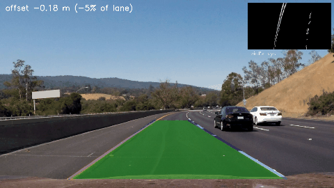

# Computer Vision Projects

Five computer-vision projects, each covering a different concept: classical image processing, transfer-learning
classification with explainability, object detection, facial-landmark analysis and multi-object tracking. Every project
folder contains its own README (problem, objective, dataset, method, tools, results, conclusion), source code,
`requirements.txt`, dataset information, results and evaluation, sample outputs and a short `REPORT.md`.

| # | Project | CV concept | Dataset | Key result |
|---|---|---|---|---|
| 1 | [Lane Detection and Departure Warning](01_lane_detection/) | Classical CV: colour spaces, Canny, Hough transform, perspective warp | Udacity lane-line videos | Both lines found in 98–100% of frames; 98.2% warning accuracy on 1,325 simulated departures |
| 2 | [Tomato Leaf Disease Classification](02_crop_disease/) | Transfer learning (ResNet-18) + Grad-CAM | PlantVillage (tomato, 10 classes) | 98.4% test accuracy; blur/noise robustness 20% → 97% with augmentation |
| 3 | [Pothole Detection](03_pothole_detection/) | Object detection (YOLOv8 fine-tuning) | Kaggle pothole dataset (665 images) | mAP@0.5 = 0.81 on the held-out test split |
| 4 | [Driver Drowsiness Detection](04_drowsiness_detection/) | Facial landmarks (MediaPipe), EAR / MAR, temporal PERCLOS | Driver Drowsiness Dataset (DDD) | 66% accuracy / 69% F1 on unseen people (temporal); live webcam demo |
| 5 | [Multi-Object Tracking](05_object_tracking/) | Tracking-by-detection: YOLOv8 + ByteTrack / BoT-SORT, Kalman + Hungarian | MOT17 (3 sequences) | MOTA 43.8%, IDF1 50.6% at 40 FPS with no training |



## Setup
```bash
git clone https://github.com/pushkardevp/cv-projects.git && cd cv-projects
python -m venv .venv && source .venv/bin/activate
pip install -r 0X_<project>/requirements.txt         # per project
bash download_data.sh <lane|tomato|pothole|ddd|mot17|all>   # datasets go to ./data (not in git)
```
Kaggle datasets (projects 2–4) need a Kaggle API token (kaggle.com → Settings → API → Create New Token).
Each project's README lists the exact commands to reproduce its results.

Tested on Ubuntu 22.04, Python 3.10, PyTorch 2 with CUDA, NVIDIA RTX 4050 Laptop GPU (6 GB). Projects 1 and 4 run on CPU only.

## Repository layout
```
download_data.sh          dataset download script (all projects)
01_lane_detection/        README.md  REPORT.md  DATASET.md  requirements.txt  src/  results/  samples/
02_crop_disease/          ...
03_pothole_detection/     ...  models/pothole_yolov8n.pt
04_drowsiness_detection/  ...  models/face_landmarker.task
05_object_tracking/       ...
```
